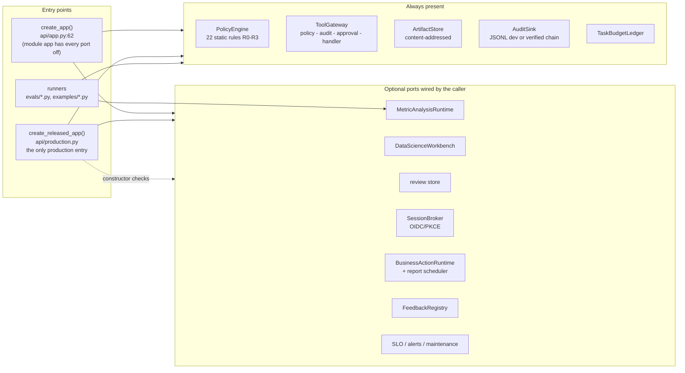
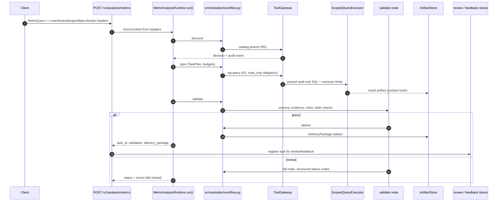
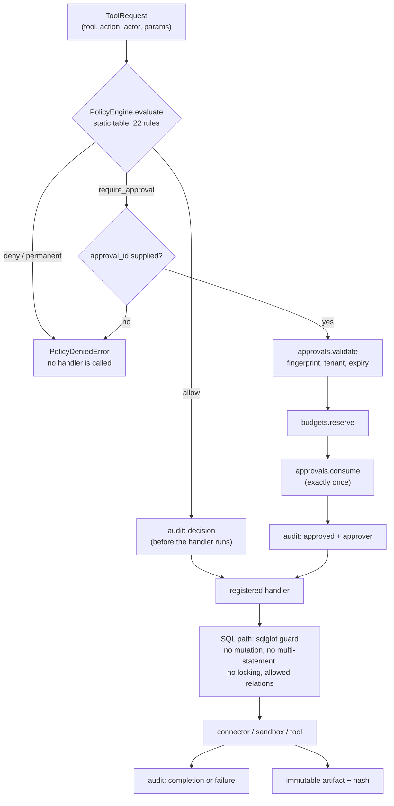
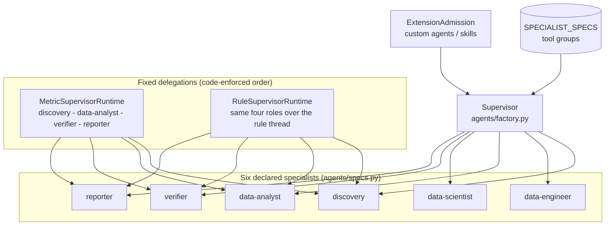
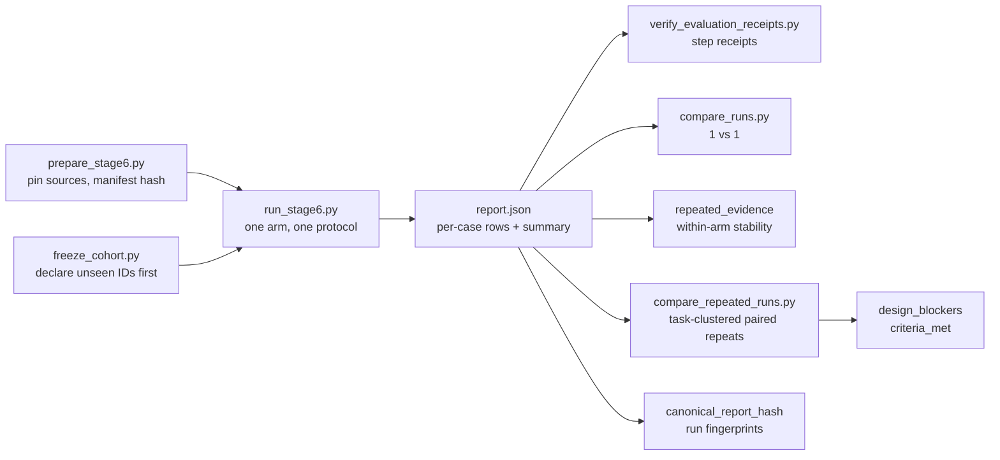
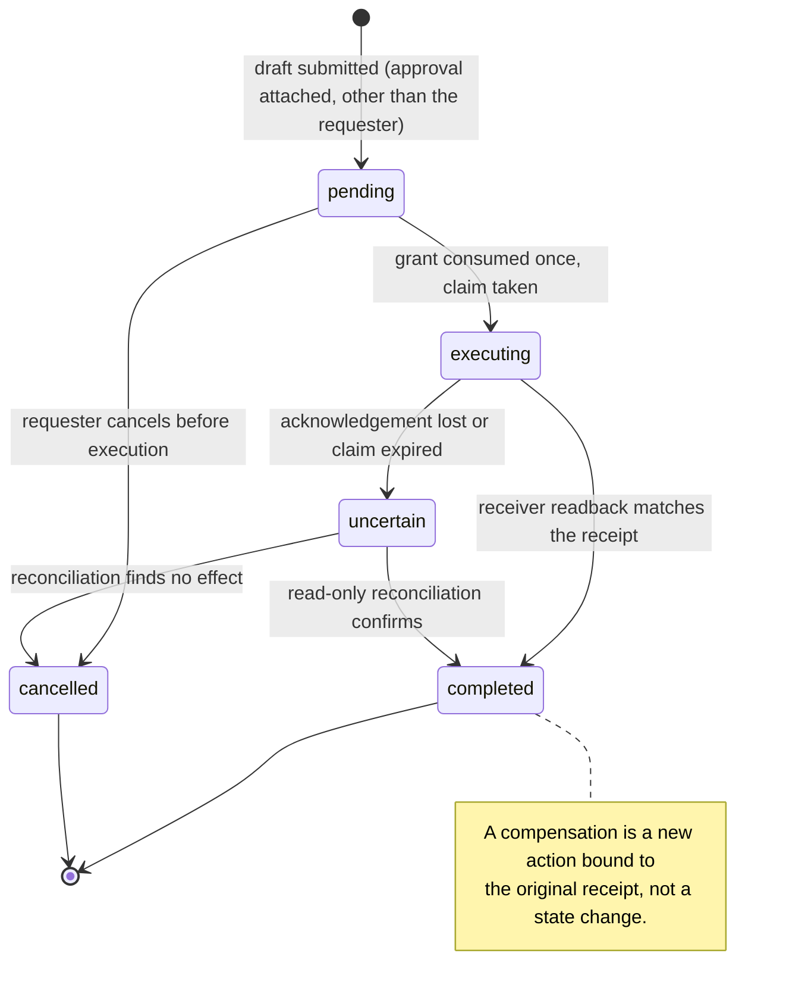

# As-built architecture

This document describes what the repository actually builds, traced from `src/generaldataagent/` at
commit `66139e5` (2026-10-28): 213 modules, roughly 40,500 lines, 19 packages. It is the companion to
[System architecture](system-architecture.md), which states the design target. Where the two differ,
the target is the intent and this page is the code.

Related: [Governance and security](governance-and-security.md), [Multi-agent collaboration](multi-agent-design.md),
[Data contracts and evaluation](data-contracts-and-evaluation.md), [Capability catalog](capability-catalog.md),
[Repository layout](repository-layout.md).

## 1. Assembly and runtime topology

There are exactly three ways to start the system, and they differ in what they require.

- `create_app(...)` takes every runtime as a keyword argument; the module-level `app = create_app()`
  therefore starts with all of them disabled and answers `503` on the corresponding routes.
- `create_released_app()` is the only production assembly. It registers no new routes: production is
  policy and wiring, not surface. It raises `ValueError` unless it receives an identity broker, a
  scoped query executor, a governed artifact store, budgets, a protected SQLite saver, verified
  audit, and qualified business/feedback runtimes, and it gates `/auth/*` on release admission.
- `evals/*.py` and `examples/*.py` construct runtimes directly and never go through HTTP.

### 1.1 Configuration surface

`config.py` declares a `GDA_`-prefixed settings contract (`GDA_ENVIRONMENT`, `GDA_ARTIFACT_ROOT`,
`GDA_STATE_ROOT`, three budget defaults, `GDA_CC_SWITCH_*`, `GDA_LLM_TIMEOUT_SECONDS`). As of this
commit that `settings` object has no importer: roots, budgets, and provider paths are passed
explicitly by each caller. Treat the variables as a documented contract for deployments, not as a
wired configuration layer — setting them changes nothing until an assembly reads them. The two
variables that do take effect are read by tests: `GDA_TEST_POSTGRES_PORT` and
`GDA_TEST_POSTGRES_PASSWORD` (CI supplies both for the real-PostgreSQL integration).

## 2. Certified metric request path

The governed path is a fixed LangGraph graph; the model proposes inside nodes, the code decides which
node runs next.

Concretely, `orchestration/workflow.py:34-51` registers `discover → plan → analyze → validate` and a
conditional edge from `validate` to `deliver` or `fail`. Every node call is wrapped by
`_with_status`, so the task state records which node ran and when. `MetricAnalysisRuntime` owns
budgets, checkpoints (`orchestration/checkpoints.py`), and the actor scope; the graph itself has no
branching that the model controls.

The rule-analysis path (`agents/rule_supervisor.py`) reuses the same delivery contract: a completed
and verified rule thread becomes a `DeliveryPackage`, delivered through the `rules.deliver` policy
entry, with one `artifact.write` authorization per artifact and a package hash registered with the
Stage 5 feedback registry.

## 3. Governance pipeline

There is one execution path, and it is not optional.

Implemented in `tools/gateway.py:53-140`. Properties worth stating precisely:

- Policy is a static table (`policy/engine.py`, `DEFAULT_RULES`, 22 rules), not a model call. Levels
  run `r0` (metadata read) to `r4`; `production.write` is `r3` with an approval and a rollback-plan
  obligation, and `permission.change` is `r4` and permanently denied. Unknown tools, unknown roles,
  and unknown actions are denied, never defaulted.
- Registration is once per tool name (`gateway.register` raises on duplicates), so a later
  registration cannot shadow an audited tool.
- In production the gateway refuses to construct without a `VerifiedAuditSink`.
- `sql.query` carries the `read_only` and `query_budget` obligations; `tools/sql_guard.py` parses with
  sqlglot and rejects mutation, multiple statements, locking reads, and unauthorized relations.
- `rules.deliver` and `artifact.write` are ordinary policy entries, so rule delivery obeys the same
  audit and approval rules as metric delivery.

## 4. Agent topology

- The six specs declare a name, description, system prompt, and tool group only; provider choice is
  separate (`llm/`).
- The benchmark runner does **not** use this supervisor. `evals/run_stage6.py` evaluates a
  `BoundedSQLAgent` in an isolated per-case subprocess (`evaluation/stage_six.py:run_isolated` →
  `evaluation/stage_six_worker.py`), with its own step/token/time budgets. Supervisor runs are
  separate entry points (`evals/run_stage10_rule_supervisor.py`, `evals/qualify_stage6_supervisor.py`,
  `examples/tlc_multi_agent_demo.py`). Keeping them apart is deliberate: a benchmark arm and a
  product assembly must be compared, not conflated.
- `agents/factory.py` builds the Deep Agents supervisor and removes filesystem/shell tools and the
  auto-summarization middleware through a registered harness profile; custom agents and Skills need
  an `ExtensionAdmission`.
- `agents/supervision.py` holds the shared ordering primitive: `record_role`, `role_sequence_stop`,
  and `continue_role_sequence`. Both supervisors use it, so a role that runs out of order ends the
  task as failed rather than being re-prompted until it looks right.
- Live-model behavior is weaker than the ordering: recorded runs have ended after `discovery` with a
  plain-text reply and no tool call. Ordering is enforced; model compliance is measured, not assumed.

## 5. Package map

| Package | Modules | Responsibility | Main entry points |
|---|---:|---|---|
| `evaluation` | 44 | Benchmark harnesses (BIRD, InfiAgent-DABench, DABstep), deterministic scorers, receipts, repeat/stability comparison, routing, frozen cohorts | `stage_six.run_benchmark`, `compare_repeated_runs`, `freeze_cohort`, `routing.route_task` |
| `business` | 28 | Business drafts, exact approvals, outbox, schedules, Feishu/GitHub receivers, capability admission, Skills | `actions.BusinessActionRuntime`, `extensions.SkillDefinition`, `governance.FeedbackRegistry` |
| `tools` | 15 | Gateway, SQL guard, SQLite/DuckDB query, science, rules and delivery handlers | `ToolGateway`, `sql_guard`, `rules` |
| `contracts` | 20 | Frozen boundary models (`extra="forbid"`) | `TaskPlan`, `ToolRequest`, `DeliveryPackage`, `ActorContext`, … |
| `data_science` | 13 | Immutable snapshots, experiment contracts, fixed-template sandbox, tracking, model cards | `DataScienceWorkbench`, `sandbox` |
| `data_engineering` | 13 | Profiling, schema diff, quality rules, transformation proposals, impact, dbt adapter | `governed runtime`, `dbt` |
| `orchestration` | 8 | LangGraph workflows, checkpoints, metric runtime, execution composition | `MetricAnalysisRuntime`, `workflow`, `checkpoints` |
| `agents` | 8 | Supervisor factory, specialist specs, supervision ordering, metric/rule supervisors | `factory`, `metric_supervisor`, `rule_supervisor`, `specs` |
| `security` | 12 | OIDC/PKCE login, sessions, native RLS adapter, DLP, release admission | `identity.SessionBroker`, `login.OIDCLoginFlow`, `release` |
| `policy` | 6 | Static rules, approvals with exact grants, budgets, pending-action resume | `engine.PolicyEngine`, `approvals`, `budgets` |
| `catalog` | 8 | Certified metric definitions and deterministic NL resolution | `resolve`, `MetricNotFoundError` |
| `llm` | 6 | CC Switch and Magpie adapters, native routing, deadlines | `cc_switch`, `orchestration` |
| `api` | 6 | FastAPI assembly, business console, production factory | `app.create_app`, `production.create_released_app` |
| `services` | 4 | Capability execution composition, shared semantics | `execution` |
| `connectors` | 5 | Read-only SQLite/DuckDB connectors, capabilities, normalized errors | `sqlite`, `duckdb` |
| `observability` | 7 | JSONL and verified/chained audit, SLO, alerts, maintenance | `JsonlAuditSink`, `VerifiedAuditSink` |
| `datasets` | 2 | Reproducible open-data ingestion (TLC) | `ingest` |
| `artifacts` | 3 | Content-addressed local store, governed store with DLP/retention | `LocalArtifactStore`, `GovernedArtifactStore` |
| `review` | 3 | Append-only human review stores, scoped variants | `LocalHumanReviewStore`, `ScopedHumanReviewStore` |

Package size is not a quality signal; it indicates where the risk sits. `evaluation` is the largest
package because protocol pinning, scoring, receipts, and comparison are all code rather than
spreadsheets.

## 6. Control, data, artifact, and observability planes (as built)

```mermaid
flowchart LR
    subgraph control["Control plane"]
        ID[identity + sessions]
        PE[policy table + approvals + budgets]
        ORCH[LangGraph workflows]
        ADM2[admission / release gates]
    end
    subgraph data["Data plane"]
        CONN[read-only connectors]
        QE[scoped query executor]
        SBX[fixed-template sandbox]
        BMK[benchmark runners]
    end
    subgraph art["Artifact plane"]
        AS[content-addressed store]
        GS[governed store: DLP, retention, holds]
        RC[execution receipts]
    end
    subgraph obs["Observability plane"]
        AU[audit: JSONL or verified chain]
        SL[ SLO + alerts ]
        MT[maintenance / retention]
    end
    control -->|ToolRequest| data
    data -->|results + hashes| art
    art -->|references| control
    control -. events .-> obs
    data -. events .-> obs
    art -. events .-> obs
```

The split is enforced by constructors rather than convention: the control plane cannot execute SQL
(it has no connector), the data plane cannot write artifacts (handlers return values and the runtime
stores them), and no component other than the audit sink may append audit events.

## 7. Evaluation harness

The evaluation path is a pipeline of separate, replayable steps. Nothing in it shares state with the
product API.

Rules the code enforces, not just documents:

- A run records `protocol_hash`, `cohort_hash`, `source_manifest_hash`, `runner_hash`, and
  `system_fingerprint`; two arms with different values are refused rather than averaged.
- `compare_repeated_runs` resamples tasks, not task-runs, and refuses a single-run arm, a duplicated
  report, an unstable arm, an unverified cost, or a cross-arm cohort change.
- `--cohort-file` turns "unseen" into an enforceable claim: the runner refuses IDs or task content
  that changed since the freeze, and a `held_out` claim without a frozen file hash is rejected.

## 8. Business loop

The stored states in `business/actions.py` are exactly `pending`, `executing`, `uncertain`,
`completed`, and `cancelled`; the approval grant is a separate column consumed once. `business/`
implements this over a durable SQLite outbox with idempotency keys, per-action switches
and owners, rate limits, revision guards, and receipts. External receivers (Feishu, GitHub) are
disabled by default; enabling one requires explicit configuration and, for production, the qualified
runtime variants. The Chinese consoles at `/business` and `/review` are served by
`api/business_ui.py` and a separate approval authority respectively.

## 9. Intentional absences

These are design decisions visible in the code, not unfinished work:

- No agent-initiated production write: `policy` exposes no mutation action for any agent role, and
  the only write path is the default-off R2 `dev_`-table pilot.
- No arbitrary code execution: the science sandbox runs one repository-owned template, and the OCI
  path hard-codes pull-never, no-network, read-only root, and capability drops.
- No model deployment: the model card fixes `deployment_approved=false` and the registry creates
  drafts only.
- No filesystem or shell tools in the supervisor: removed by the harness profile at construction.
- No claim of production acceptance anywhere in the repository; `production_accepted` is `false` by
  construction in the evaluation and release paths.
