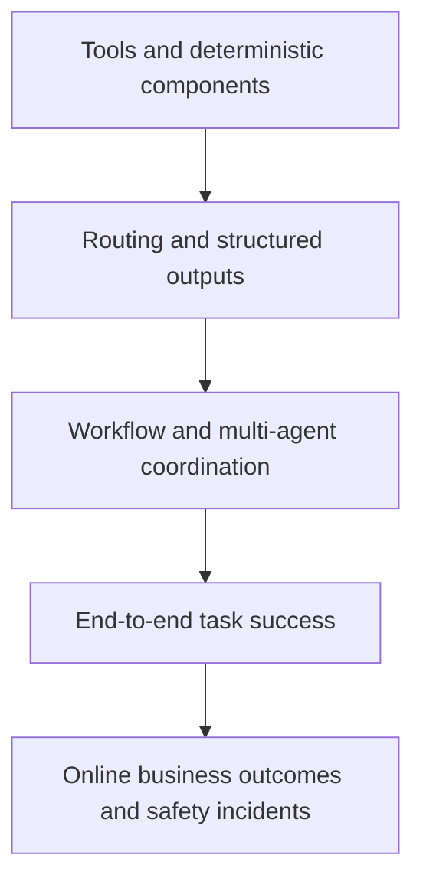

# Data contracts and evaluation architecture

Versioned contracts connect system layers; layered evaluation checks whether work actually meets requirements. This is a design specification. Historical runs and acceptance progress are maintained [outside the implementation repository](../../../docs/validation/README.md).

> Several tables below name design-stage contracts that were implemented under other names (`TransformationProposal`, `ExperimentSpec`/`ExperimentReport`, `GroundedClaim`). The implemented contract set, execution receipts, and the benchmark harness are documented in [As-built architecture](as-built-architecture.md) and the [capability catalog](capability-catalog.md).

## 1. Artifact contracts

| Artifact | Producer | Required content | Consumers |
|---|---|---|---|
| `SemanticContext` | Discovery | Metric versions, entities, datasets, ambiguities, sources | Planner, Analyst, Engineer, Scientist |
| `TaskPlan` | Supervisor | DAG, roles, inputs/outputs, resources, risk, gates | Runtime and all roles |
| `QueryPackage` | Analyst/Engineer | SQL, dialect, parameters, snapshot, explain, result reference | Executor, Verifier |
| `DataProfile` | Engineer | Schema, distributions, missingness, uniqueness, anomalies, rules | Planner, Scientist, Verifier |
| `TransformationSpec` | Engineer | Transformations, dependencies, tests, impact, rollback | Dry-run workflow, Verifier |
| `ExperimentPlan` | Scientist | Hypothesis, split, metrics, baseline, methods, stopping rules | Training workflow, Verifier |
| `ModelRun` | Scientist | Code, environment, snapshot, parameters, seeds, metrics, model reference | Verifier, registration workflow |
| `InsightSet` | Analyst | Claims, evidence, confidence, limitations, recommendations | Verifier, Report |
| `ValidationResult` | Verifier | Checks, status, failure codes, evidence, revision advice | Supervisor, HITL |
| `DeliveryPackage` | Report | Channel, content, references, classification, approval | Users and business systems |

Every artifact carries `schema_version`, `artifact_id`, `task_id`, `created_at`, `created_by`, `content_hash`, `classification`, and `lineage`.

## 2. Evidence chain

Every final `Claim` links to at least one `Evidence`:

```json
{
  "claim_id": "clm_123",
  "text": "New Android users contributed 61% of this week's conversion decline",
  "claim_type": "descriptive",
  "confidence": 0.88,
  "evidence": [{
    "artifact_uri": "artifact://query/result/789",
    "query_id": "qry_456",
    "data_snapshot": "warehouse@2026-10-13T10:00:00+08:00",
    "location": {"row": 4, "columns": ["platform", "user_type", "contribution_pct"]}
  }],
  "limitations": ["Excludes Sunday orders not yet backfilled"]
}
```

Types include `observed`, `descriptive`, `associational`, `causal`, `forecast`, and `recommendation`. Apply type-specific verification; descriptive queries do not establish causation or predictive generalization.

## 3. Quality gates

### 3.1 Data

Verify authorized catalog objects, pinned metric definitions, required freshness, missingness/duplicates/outliers/sampling bias, result cardinality, time range, units, and time zone.

### 3.2 SQL

Require AST validity and permitted read-only operations, authorized references, acceptable explain/scan/cartesian-product risks, and semantically correct time filters, joins, grain, and aggregation. Compare with authoritative queries or independent recomputation within declared tolerance. Offline reference queries must not enter model-solving context.

### 3.3 Data science

Verify time-aware splits and no target leakage, reproducible train/validation/test sets, naive/current baselines, metrics matching business loss, subgroup/stability/calibration/error analysis, and model-card scope, prohibited uses, and limitations.

### 3.4 Delivery

Require evidence for factual claims; complete chart titles, axes, units, time ranges, and filters; separation of facts/interpretation/hypotheses/recommendations; export-compliant sensitive columns and small groups; and reproducibility from recorded inputs/code.

## 4. Evaluation pyramid



- **Tools:** unit/integration checks for connectors, SQL guard, catalog, sandbox, artifact store, and policy. Distinguish success, empty, truncated, denied, and transient-error results.
- **Agents:** routing, plan completeness, schemas, tools, abstention, citations, and limitations under fixed inputs and mock tools.
- **Workflows:** parallel joins, retries, cancellation, checkpoint recovery, HITL, denials, partial success, and termination. Inject source timeouts, schema drift, sandbox failure, and verification rejection.
- **End to end:** analytics metrics/trends/anomalies/segments/attribution limits/charts; engineering profiles/rules/proposals/impact/diagnosis; science EDA/tests/experiments/baselines/errors/model cards. Tasks declare an authoritative answer or grader, sources, risk, resources, and artifacts.

## 5. Metrics

| Dimension | Metric | Definition |
|---|---|---|
| Correctness | Task Success Rate | Tasks passing every required artifact and critical check |
| Grounding | Claim Grounding Rate | Factual claims with valid evidence bindings |
| SQL | Execution Accuracy | Executable queries matching authoritative results within tolerance |
| Routing | Agent Routing Accuracy | Role/workflow choices matching labels |
| Semantics | Metric Resolution Accuracy | Correct metrics, dimensions, and filter definitions |
| Reproducibility | Reproducibility Rate | Reruns matching within tolerance on fixed data/environment |
| Safety | Unauthorized Action Count | Successful unauthorized reads, writes, exports, external actions |
| Latency | Time to First Useful Output | Time to first verifiable intermediate result |
| Cost | Cost per Successful Task | Total model, query, and compute cost for successful tasks |
| Recovery | Recovery Success Rate | Correct checkpoint continuation after interruption/failure |

The original initial-cohort recommendation is maintained in the [external dataset plan](../../../docs/planning/initial-evaluation-dataset-plan.md).

## 6. Online evaluation

Record task success/human takeover/rejection/cancellation/timeouts; step routing/tool errors/tokens/latency/scan/sandbox/retries; corrections/citation clicks/reuse/report edits; and denials/unauthorized attempts/exports/injection/sandbox alerts. De-identify, aggregate, and review feedback before admitting it to datasets, rules, prompts, or long-term memory.

## 7. Release gates

The original design blocks release on any successful unauthorized safety case, core success falling by more than 3 percentage points, grounding below the production baseline, incompatible in-flight checkpoints without migration, breaking artifact schemas without a major version, or cost/P95 more than 20% above approved budgets without demonstrated value. Phase-specific non-regression requirements may be stricter; use the [external acceptance criteria](../../../docs/planning/phase-acceptance.md). These are criteria, not proof of admission.
