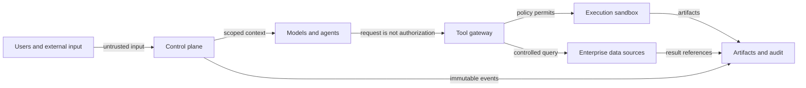

# Governance and security design

The system handles enterprise data, executable code, and potentially consequential production actions. Authorization is enforced technically, with audit evidence for allowed actions. This reference design does not establish production admission; see the [external acceptance records](../../../docs/validation/README.md).

## 1. Trust boundaries

Treat user input, documents, retrieved content, and model output as untrusted. Tool requests require identity, policy, parameter, and risk checks.

## 2. Identity and authorization

Each task carries tamper-resistant user, tenant, department, project, role, purpose, session, task, approval-chain, and client-origin context. Agents see a scoped display view and cannot alter authoritative identity claims.

RBAC controls product features. ABAC evaluates domain, sensitivity, purpose, environment, geography, and time. Native RLS/CLS is the final data boundary. Tool permissions govern actions; filesystem permissions govern virtual paths. Decisions consume subject/resource/action/environment/risk and return allow/deny, approvals, redaction duties, row limits, and audit level.

## 3. Credentials

Long-lived secrets never enter agent/model context. A broker issues short-lived tokens bound to user, task, domain, and read/write scope. Do not put credentials in artifacts, logs, traces, checkpoints, or memory. Redaction is a tool-layer responsibility, not a prompt-only request. Revoke credentials when tasks finish, cancel, or change authorization.

## 4. Tool risk classes

| Class | Examples | Default policy |
|---|---|---|
| R0 | Catalogs, public documents, authorized summaries | Allow and audit |
| R1 | Read-only SQL, controlled Python, charts | Allow within applicable execution policy and sandbox |
| R2 | Detailed exports, development writes, expensive compute | Conditional or mandatory approval |
| R3 | Production writes, DDL, pipeline/model publication, external sends | Fixed workflow and dual/designated-role approval |
| R4 | Permission changes, secret reads, disabling audit, cross-tenant access | Permanently unavailable to agents |

R2/R3 approval views show exact action, target, parameters, impact, estimated cost, sensitivity, rollback, and expiry. An ambiguous permission to continue is insufficient.

## 5. SQL and data access

Parse dialect-aware ASTs, apply policy, explain, then execute. Default-deny DDL, DML, multiple statements, unscoped cross-domain joins, and unapproved UDFs. Enforce applicable time range, row/scan, duration, and concurrency policies. Tag queries with user/task identifiers. Protect sensitive fields, small groups, and re-identification risks. Viewing and downloading details are distinct permissions; delivery rechecks export policy.

## 6. Code execution

Production uses short-lived isolated sandboxes rather than an unisolated local shell:

- Non-root execution, read-only base image, temporary writable directory.
- No default internet; explicitly allow domains and methods.
- CPU, memory, disk, process, GPU, duration, and output constraints.
- Approved images/dependency sources; no arbitrary runtime installation.
- Minimize imported raw data, prefer computation near sources, and destroy task data appropriately.
- No host sockets, home directories, production configuration, or cloud metadata mounts.
- Record code, lockfiles, input references, output hashes, and exit status.

## 7. Prompt injection and content safety

Keep data and system instructions in distinct channels. Retrieved text cannot change tools, permissions, models, or system prompts. Admin-review and sign connector/Skill registrations. Tool schemas reject undeclared fields. Deny requests to expose secrets, bypass policy, expand paths, or disable audit. Record suspicious-instruction matches as security telemetry without propagating raw content through ordinary logs.

## 8. Protection and lifecycle

| Object | Initial retention recommendation | Protection | Deletion |
|---|---|---|---|
| Thread state | 30 days | Tenant isolation, encryption | Expiry or user request |
| Query artifacts | 7 days | Inherited access, field redaction | Expiry |
| Approved reports/delivery | Business policy | Version, access, watermark | Owner approval |
| Audit events | Compliance policy | Append-only, independent permissions | Compliance process |
| Evaluation samples | Long-term, de-identified | Review and minimization | Governance process |
| Credentials | Task lifetime | Secret service, memory-only use | Immediate revocation |

Enterprise policy overrides these illustrative durations; they are not universal deployed settings.

## 9. Audit events

Events include ID, timestamp, actor, tenant, task/thread, agent, model version, action/resource, parameter summary, policy decision, approval, result, input/output hashes, and trace ID. Record identity establishment, plan creation/changes, every model/tool/data/artifact access, policy duties/denials, HITL request/edit/approve/reject/resume, delivery/export/external actions/deletion, and agent/Skill/prompt/model/policy/connector changes. Ordinary telemetry may be sampled; security audit must not be sampled.

## 10. Threats and controls

| Threat | Controls | Verification |
|---|---|---|
| Unauthorized read | Propagated identity, ABAC, RLS/CLS, short-lived tokens | Cross-role/tenant negative tests |
| Accidental production write | Read-only defaults, AST guard, fixed workflow, approval | DML/DDL and parameter-confusion red teams |
| Prompt injection | Instruction/data separation, schemas, external policy | Malicious documents and field contents |
| Exfiltration | Network allowlist, redaction, export approval, DLP | Export and encoding-bypass tests |
| Sandbox escape | Hardened unprivileged containers, resource/network controls | Image scanning and escape tests |
| Replay/duplicate effects | Idempotency, expiry, nonce | Retry/recovery fault injection |
| Audit tampering | Append-only storage, independent roles, signature/hash chain | Integrity verification |
| Uncontrolled cost | Multidimensional production policies, cancellation, pacing, circuit breakers | Large-query and recursive-task tests |

## 11. Production security criteria

Require fixed workflows and verified approval recovery for R3; zero successful unauthorized cross-tenant/role access; zero sensitive-field leakage into ordinary logs, traces, checkpoints, or reports; no sensitive host mounts or default sandbox internet; named incident owners, severity, notification, and response deadlines; and threat modeling, penetration tests, and recovery drills before production release. Passing local fixtures alone does not close these criteria.
