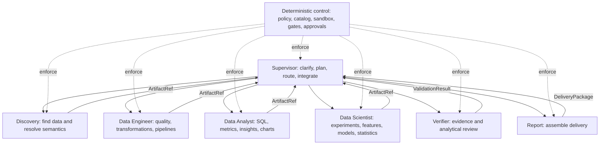

# Multi-agent collaboration design

This reference design defines roles, collaboration contracts, context boundaries, and failure handling for analytics, data engineering, and data science. Planned implementation and actual qualification are tracked in the [external phase plans](../../../docs/planning/development-roadmap.md).

## 1. Organization



Specialists normally do not call each other. They persist artifacts; the Supervisor advances the plan. This central coordination makes responsibility, effective permissions, and replay explicit.

## 2. Roles

### 2.1 Supervisor

Select direct-tool, dynamic-specialist, or fixed-graph execution. Ask the minimum necessary clarification, create/update/terminate `TaskPlan`, and route by declared capabilities, input contracts, risk, and resources. Receive structured summaries and references; integrate only verified conclusions. Do not execute raw SQL, training code, or production writes, grant permissions, or replace independent verification.

### 2.2 Discovery

Search catalogs, resolve metrics and terms, rank table/column candidates, retrieve lineage and existing assets, and assess availability. Return `SemanticContext`, `DatasetCandidateList`, and ambiguities. Tools are read-only catalog, semantics, lineage, and document retrieval; fact-table access is not a default permission.

### 2.3 Data Engineer

Perform profiling, schema comparison, draft quality rules, SQL/dbt proposals, dependency impact, backfill/repair planning, and pipeline-log diagnosis. Return `DataProfile`, `TransformationSpec`, `PipelineChangeProposal`, and `ImpactAnalysis`. The initial boundary permits read, compile, test, dry run, and proposals; development writes and PR creation are separately approved extensions.

### 2.4 Data Analyst

Compute metrics, compare slices, examine trends/anomalies, propose attribution hypotheses, visualize, and interpret business results. Return `QueryPackage`, `AnalysisResult`, `ChartSpec`, and `InsightSet`. Separate observations, statistical association, causal claims, and recommendations. Correlation alone does not establish causation.

### 2.5 Data Scientist

Perform EDA, experiment design, tests, feature engineering, baselines, training/evaluation, error analysis, explanation, and model cards. Return `ExperimentPlan`, `DatasetSnapshot`, `ModelRun`, `EvaluationReport`, and `ModelCard`. Pin data, code, dependencies, seeds, and splits. A fixed approved workflow, not the specialist, admits a model to production.

### 2.6 Verifier

Review semantics, queries, statistics, provenance, and delivery consistency through independent deterministic checks. Return `ValidationResult` with `pass`, `fail`, or `needs_human`, plus failure codes, evidence, and revision advice. Do not acquire undisclosed privileges or modify original artifacts.

### 2.7 Report

Assemble channel-specific `DeliveryPackage` output, consistent tables/charts/narrative, limitations, and complete references. Do not add factual conclusions. Additional computation or interpretation returns to the Supervisor as a new step.

## 3. Choosing orchestration

| Situation | Mechanism | Example |
|---|---|---|
| One deterministic low-risk step | Single agent/tool | Read a certified metric definition |
| Exploratory multi-step task | Dynamic Supervisor delegation | Investigate declining conversion |
| Independent contexts and inputs | Asynchronous specialists | Profile three independent domains |
| Fixed branches, approval, or compensation | CompiledSubAgent or main LangGraph | Backfill, model release, notification |
| Production write or cross-domain export | Fixed graph and HITL | Publish dbt changes or export details |

Split work only when it needs multiple calls, specialist tools/prompts, an independent model, or substantial intermediate context. A simple query does not require a subagent.

## 4. Task protocol

Illustrative production task contract; numerical resource settings are examples, not current research-evaluation token defaults:

```json
{
  "task_id": "tsk_...",
  "parent_task_id": "tsk_...",
  "agent_role": "data_analyst",
  "objective": "Analyze weekly payment conversion and identify contributing dimensions",
  "inputs": [{"artifact_uri": "artifact://semantic/context/123", "sha256": "..."}],
  "constraints": {
    "data_domains": ["commerce.payment"],
    "read_only": true,
    "max_runtime_seconds": 600,
    "max_scan_bytes": 10737418240,
    "max_tokens": 30000
  },
  "expected_outputs": ["QueryPackage", "InsightSet"],
  "acceptance_checks": [
    "metric_version_is_pinned",
    "query_is_read_only",
    "all_claims_have_evidence"
  ],
  "deadline": "2026-10-13T18:00:00+08:00"
}
```

Illustrative response:

```json
{
  "task_id": "tsk_...",
  "status": "completed",
  "summary": "Weekly payment conversion fell 2.1 percentage points, concentrated among new Android users.",
  "artifacts": [{"uri": "artifact://analysis/result/456", "type": "InsightSet", "sha256": "..."}],
  "confidence": 0.82,
  "limitations": ["Sunday data has not been fully backfilled"],
  "next_actions": ["Rerun the same QueryPackage after backfill"]
}
```

Free-text summaries help humans and the Supervisor; machine transitions consume structured fields.

## 5. Context and memory

| Context | Lifetime | Content | Storage |
|---|---|---|---|
| Turn | One model call | Minimum current-step inputs | Model context |
| Task | One task | Plan, concise summaries, references | Checkpointer/task store |
| Workspace | Project/session | User files, temporary/shared artifacts | Isolated backend |
| Organizational | Across tasks | Certified metrics, terms, Skills, policies | Governed knowledge/configuration |

Persist user preferences where authorized, but revalidate business facts against authoritative data/semantics. Never store sensitive results or credentials in long-term memory. Checkpoints preserve execution state, not organizational truth.

Large results go to artifact storage. Return URI, bounded previews, schema, row counts, summaries, and checksums; read partitions on demand rather than reinject full results.

## 6. Routing

Combine hard rules for type/risk/domain/tools/fixed workflows, concrete mutually distinguishable role descriptions, and routing evaluation on labeled requests. Clarify or escalate low-confidence routing. Production writes, sensitive exports, and model publication require hard-rule routing rather than unrestricted LLM judgment.

## 7. Parallel and asynchronous execution

Examples include independent metadata retrieval, dataset profiling, model candidates, and charts. Pin inputs, avoid shared writes, give each subtask independent deadlines/resources, define partial-success/missing-result/cancellation behavior at joins, and use idempotency keys. Serialize data dependencies, shared writes, and approval order.

## 8. Failure, retry, and fallback

| Failure | Design response |
|---|---|
| Transient network/service failure | Exponential backoff, at most two retries, same idempotency key |
| SQL syntax/schema change | Return to generator, at most two revision rounds |
| Semantic ambiguity | Pause and clarify |
| Permission denial | No retry; identify minimum missing access |
| Resource limit | Reduce approved scope or request resources; no silent quota increase |
| Verification failure | Targeted revision by failure code, then human review when exhausted |
| Sandbox/policy violation | Terminate and record a security event |
| Unresponsive specialist | Cancel, preserve completed artifacts, replay on an approved replacement |

These are reference workflow policies. The evaluation runner may intentionally use stricter no-retry behavior; use its [protocol](benchmark-evaluation-protocol.md).

## 9. Role registration

Register a unique name and concrete description; full prompt with duties, exclusions, contracts, and stopping rules; explicit tools/Skills/model/permissions/response schema; resource policy; permitted data/network/artifact scopes; evaluation fixtures, admission thresholds, and rollback version. Do not implicitly inherit the Supervisor's complete toolset in production; expand and review the effective list.

## 10. Preventing uncontrolled collaboration

Reference defaults are delegation depth 2 and at most 20 subtasks, configurable by task type. Specialists lack the `task` tool unless separately admitted. Do not delegate identical inputs/objectives more than twice. Reflection must add evidence, parameters, or a method; stop unchanged repetition. Exhausted configured production limits lead to `needs_human`, not automatic expansion. Research evaluation currently has no default token ceiling, while action/time controls and complete usage telemetry remain in force.
