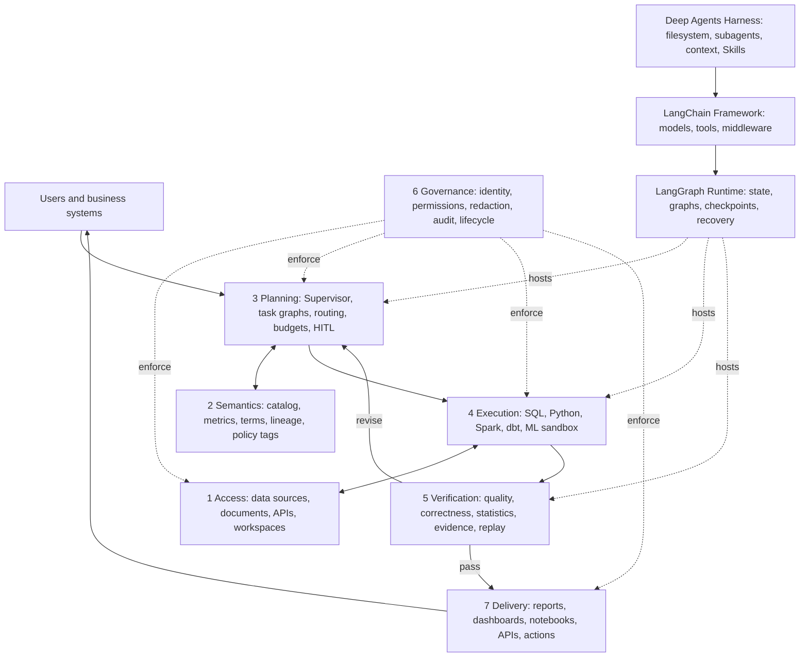
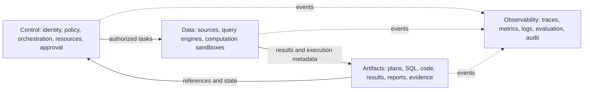
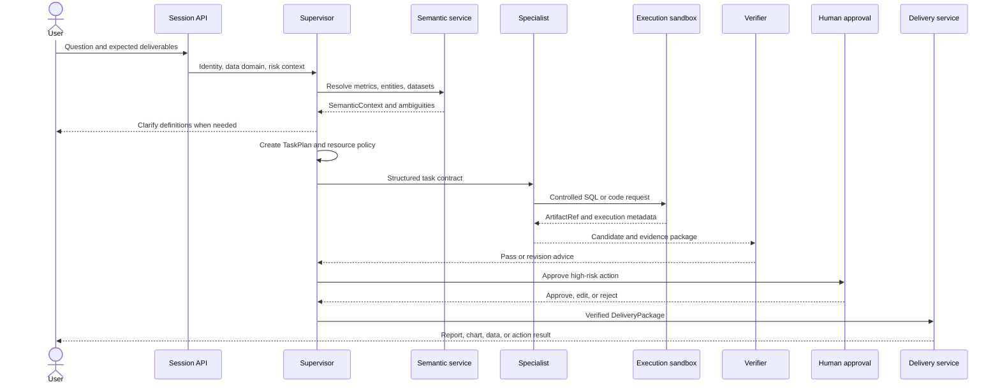

# Data intelligence multi-agent architecture

The target architecture brings analytics, data engineering, and data science into one auditable task plane. Specialists collaborate under deterministic semantic, authorization, execution, and verification controls to produce reproducible results. This is an architecture specification, not a claim that every integration is implemented; see the [implementation inventory](../../../docs/progress/implementation-status.md).

## 1. Goals and scope

### 1.1 Business capabilities

- Analytics: metric questions, attribution analysis, segmentation, trends, anomaly diagnosis, charts, and narrative reports.
- Data engineering: discovery, quality analysis, SQL/dbt proposals, dependency analysis, backfill plans, and pipeline diagnosis.
- Data science: EDA, features, experimental design, statistical tests, model evaluation, and model cards.
- Shared requirements: provenance, recovery, scoped authorization, controlled costs, and approval of consequential actions.

### 1.2 Initial access boundary

Agents do not autonomously modify production tables, pipelines, or models. Arbitrary shell access, network access, and software installation require separate review. LLM output cannot establish authorization, data quality, or compliance. Ambiguous questions need clarification or an explicit fallback. Delivery milestones belong in the [phase plans](../../../docs/planning/development-roadmap.md).

## 2. Overall architecture

The seven business layers describe the capability loop. Runtime, Framework, and Harness describe how it is built; the views are orthogonal.

## 3. Layer responsibilities

### 3.1 Access

Unify connection interfaces rather than replicate all data. Candidate sources include PostgreSQL, MySQL, ClickHouse, Trino, Snowflake, BigQuery, lakehouses, and object stores. Analytical assets include BI semantics, dashboards, notebooks, model registries, and feature stores. Unstructured assets include dictionaries, requirements, web pages, PDFs, and knowledge bases.

Isolate tenant, department, project, and user workspaces into temporary artifact and read-only input areas. Connectors explicitly declare read, write, DDL, transaction, sampling, cost-estimation, and cancellation capabilities. A credential broker issues short-lived task-scoped access; long-lived secrets never reach agents.

### 3.2 Semantics and ontology

- Catalog tables, columns, volumes, dashboards, metrics, models, features, and external assets.
- Define metric versions, dimensions, time grains, filters, units, ownership, and certification.
- Resolve entities, attributes, events, synonyms, prohibited terms, and conflicting definitions.
- Record table lineage, metric dependencies, report references, model/feature dependencies, and cross-domain mappings.
- Expose sensitivity, data domain, retention, quality, trust, and permitted environments.

A `SemanticContext` contains resolved entities, metric versions, candidate datasets, ambiguities, and sources. Multiple valid definitions for a critical metric require clarification.

### 3.3 Planning and orchestration

The Supervisor, task graph service, and policy decision points:

1. Identify task type, deliverables, timeliness, and risk.
2. Consult semantics and identify clarification questions.
3. Produce a versioned `TaskPlan` with inputs, outputs, owners, resources, permissions, and acceptance checks per step.
4. Delegate exploratory work to specialists.
5. Route high-risk work through prebuilt LangGraph workflows.
6. Handle parallelism, deadlines, retries, cancellation, compensation, approvals, and fallback.

Planners request permissions; only governance grants them.

### 3.4 Execution

| Domain | Capabilities | Constraints |
|---|---|---|
| SQL | Explain, sampling, read-only queries, persisted results | AST checks, row/scan limits, deadlines, query tags |
| Data engineering | Profiling, schema diff, dbt compile/test, DAG analysis | Initial proposals and dry runs; no direct production deployment |
| Python | pandas, polars, statistics, visualization | No default internet; CPU, memory, time, and file quotas |
| Spark | Large transformations and feature computation | Queue/cost controls; approved submission templates |
| Data science | Training, evaluation, experiment records, model cards | Pinned snapshots, seeds, and environments |
| Documents | Extraction, retrieval, table parsing | Source pages and content fingerprints |

Execution returns `ArtifactRef` objects. The main context receives summaries and references, not full results.

### 3.5 Verification and reflection

Run gates in order; failure blocks later gates:

1. Structural: schema, required fields, types, URIs, checksums, and versions.
2. Execution: query validity, process exit, locked dependencies, applicable nonempty-result checks, and resource compliance.
3. Analytical: consistent definitions, sample sizes, assumptions, leakage, baselines, outliers, and sensitivity.
4. Delivery: evidence-bound claims, correct chart axes/units, visible limitations, and protected sensitive data.

A verifier requesting revision supplies machine-readable failure codes and advice. Repeated failure reaches an explicit stop or human review, not unlimited self-reflection.

### 3.6 Governance and security

Governance applies throughout: SSO and service identity; tenant/project context; RBAC/ABAC and native RLS/CLS; tool/path authorization; classification, redaction, watermarks, encryption, residency and export controls; isolated task execution; approved networks; complete audit; retention, deletion, and versioned connector/Skill review.

### 3.7 Delivery

`DeliveryPackage` can contain result tables/downloads, charts or dashboard drafts, narrative summaries, reproducible notebooks/SQL, engineering proposals with impact/rollback, experiment reports/model cards, and follow-up drafts. Distinguish observations, interpretations, hypotheses, limitations, and recommendations. External sends, tickets, schedule publication, and production changes require applicable human approval.

## 4. Control, data, artifact, and observability planes

The control plane handles metadata and summaries. Compute near the data and minimize cross-domain raw-data transfer. Artifact storage holds authorized reproducibility evidence. Engineering telemetry and compliance audit remain distinct; agents cannot edit audit records.

## 5. End-to-end task sequence

## 6. Technology interface choices

| Capability | Starting point | Responsibility |
|---|---|---|
| Harness | Deep Agents | Filesystem, specialists, context, Skills |
| Framework | LangChain | Model, tool, and middleware abstractions |
| Runtime | LangGraph | Durable graphs, checkpoints, HITL |
| API | FastAPI or comparable ASGI | Streaming, identity, task API |
| Metadata | Existing DataHub, OpenMetadata, or internal catalog | Adapt rather than duplicate enterprise catalogs |
| Semantics | Existing metric platform or dbt Semantic Layer | Governance owns definitions |
| Artifacts | S3-compatible objects with relational index | Separate large objects and queryable metadata |
| Sandbox | Per-task containers or isolated remote execution | No production LocalShellBackend |
| State/queue | PostgreSQL and a message queue | Thread state, task events, idempotency |
| Observability | OpenTelemetry and LangSmith or equivalent | Link technical traces and business evaluation |
| Policy | OPA or internal service | Decisions outside the agent |

Specific products require discovery and ADRs; this design specifies interfaces and ownership.

## 7. Architectural decisions

- One Supervisor owns task state and delivery integration. Specialists exchange contracts/artifacts rather than unrestricted conversations.
- Use dynamic routing for low-risk exploration, fixed graphs for high-risk work, and direct tools for simple single-step tasks.
- Shared backends contain versioned artifacts. Specialists return concise summaries and references rather than entire results, logs, or notebooks.
- Independent verification and policy checks are mandatory. Agent self-review is supplementary.

## 8. Nonfunctional design objectives

Recover task state and completed artifacts after individual failures. Add roles, tools, connectors, and delivery channels without changing the core task protocol. Stream interactive feedback; support asynchronous cancellation for long jobs. Govern production resources across queries, compute, and APIs; research evaluation currently has no default cumulative or per-call token ceiling and still records usage. Trace a conclusion to its snapshot, code, execution, and approval within 10 minutes. Unauthorized reads or production writes must have zero successful cases.
