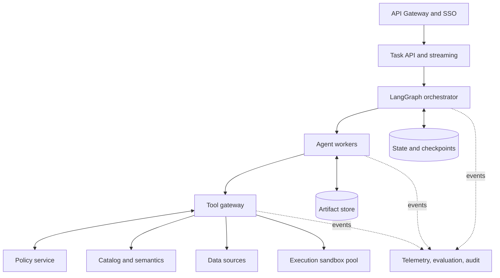

# Deployment and operations reference

This guide defines target environments, rollout, observability, SLOs, and incident handling. Deployment ADRs specify actual cloud and network choices. Design objectives do not imply production acceptance; phase progress is tracked [outside this repository](../../../docs/validation/README.md).

## 1. Environments

| Environment | Data | Tools | Purpose |
|---|---|---|---|
| local | Synthetic/local examples | Mock tools and restricted files | Unit development and prompt debugging |
| dev | De-identified snapshots | Read-only data and development sandbox | End-to-end development |
| staging | Authorized/de-identified production-shaped copies | Production-equivalent policy, mock external targets | Regression, security, and recovery drills |
| production | Authorized live data | Read-only by default; approved R2/R3 | Controlled user service |

Never copy production credentials into local/dev. Isolate state, artifacts, memory, and secrets across environments.

## 2. Production components



API/orchestrator components do not hold long-lived source credentials. The tool gateway enforces policy and exchanges credentials. Workers see tool schemas and result references.

## 3. Task state machine

```text
created -> clarifying -> planned -> running -> validating
        -> waiting_for_approval -> delivering -> completed
        -> failed | cancelled | expired | needs_human
```

Transitions are atomic and audited. Waiting approvals occupy no compute worker. Resume with the same thread ID after validating approval expiry and resource revisions. Terminal tasks cannot return to running; create a linked task for continuation.

## 4. Observability

### 4.1 Traces

Cover intake, planning, every model call, delegation, tool, sandbox, verification, approval, and delivery. Spans include versions, timing, tokens, scan volume, resources, and outcomes, never plaintext secrets or unredacted sensitive data.

### 4.2 Metrics

Measure task/concurrency/tool volume; success/failure/timeouts/cancellation/recovery/human takeover; first event/useful output and step/total P50/P95/P99; routing/rejections/grounding/corrections/regression; tokens/scan/CPU/GPU/storage/API cost; and policy, approval, export, injection, and sandbox events.

### 4.3 Logs and audit

Application logs support diagnosis, sampling, and retention. Compliance audit is unsampled and independently authorized. Link both by task/trace IDs while separating storage and access.

## 5. SLOs and error budgets

Original design targets, subject to qualified deployment policy:

| Service | Measure | Target |
|---|---|---|
| Task API | Monthly availability | 99.5% |
| Streaming state | P95 event delay | Under 3 seconds |
| Read-only analysis | P95 first verifiable output | Under 60 seconds |
| State recovery | Successful recovery | At least 99% |
| Audit | Required-event ingestion | 100% |
| Safety | Successful unauthorized action | 0 |

For long queries/training, track queueing, heartbeat, visible progress, cancellation response, and resource enforcement rather than one universal total-duration SLO.

## 6. Release procedure

1. Pin code, model, prompts, Skills, schemas, policy, and evaluation datasets.
2. Run unit, integration, workflow, full offline, and security checks.
3. Exercise checkpoint, provider, source, and sandbox failures in staging.
4. Shadow production requests without delivery or side effects.
5. Canary by tenant, user, and task type; observe quality, safety, cost, latency.
6. Expand after the observation window; blocking signals trigger rollback or capability disablement.

Apply release governance to agent configuration and code alike. Do not edit production prompts without a recorded revision.

## 7. Compatibility and migration

Use semantic versions for tasks/artifacts; breaking changes increment the major version. Support current and previous schema majors until in-flight tasks drain. Checkpoint upgrades need migration or retained old workers. Shadow model upgrades before broad replacement. Content-hash Skills and semantic rules so each task identifies the original version.

## 8. Capacity and pacing

Apply quotas by user, tenant, task type, model, source, query queue, and sandbox pool. Prefer interactive reads over batch profiles, approval resumption over new long jobs, and separate large-training queues.

Production policies may bound calls/tokens, subtasks/depth, SQL scans/rows/concurrency/time, sandbox CPU/memory/disk/GPU/network, and artifact size/retention. Insufficient approved resources require scoped fallback, approval, or human review rather than silent expansion. Current research evaluation has no default cumulative or per-call output token cap; do not reintroduce one through this illustrative production policy. Record actual usage.

## 9. Incidents

| Failure | Automatic response | Operator action |
|---|---|---|
| Model provider | Circuit break, approved fallback, or pause | Assess quality differences and restoration |
| Source timeout | Bounded retry, cancellation, checkpoint | Inspect source health/queues |
| Schema drift | Block, refresh metadata, replan | Owner confirms compatibility |
| Sandbox capacity | Queue or return plan/code draft | Add capacity or reprioritize |
| Policy outage | Fail closed for protected tools | Restore service; no bypass |
| Artifact outage | Stop dependent work | Restore and verify hashes |
| Audit outage | Block R2/R3; policy-defined R0/R1 degradation | Restore and backfill provable events |
| Quality regression | Disable affected task type or roll back | Analyze failures and review again |

## 10. Kill switches

Provide tool/connector, agent/task-type, tenant/domain, and global-new-task switches. Preserve query state and reviewed recovery. Switches require independent authorization and audit. Stop side effects first during security incidents; retain evidence.

## 11. Routine operations

### Daily

Review blocking incidents, failed/rejected tasks, anomalous cost, and long jobs. Sample high-impact evidence chains and corrections. Check sources, policy, sandbox, and artifact health.

### Weekly

Analyze success, cost, latency, routing errors, and takeover. De-identify new failures and review them before dataset admission. Recheck role/tool/connector least privilege.

### Monthly

Exercise recovery, permission denials, and deletion samples. Review model/prompt/Skill/policy/dependency upgrades. Evaluate value and disable low-value expensive task types.

## 12. Pre-release operations checklist

- [ ] No unisolated local shell in production configuration.
- [ ] Separate service identities and least privilege.
- [ ] Exercised backup, restore, retention, and deletion.
- [ ] Owned alerts with severity and runbooks.
- [ ] Quality, reliability, cost, and security dashboards.
- [ ] Rollback and kill switches verified in a production-equivalent environment.
- [ ] Pilot users understand boundaries, approval responsibilities, and feedback.

This checklist is an operator reference. Actual approvals and test outcomes belong in the [external acceptance records](../../../docs/validation/README.md).
